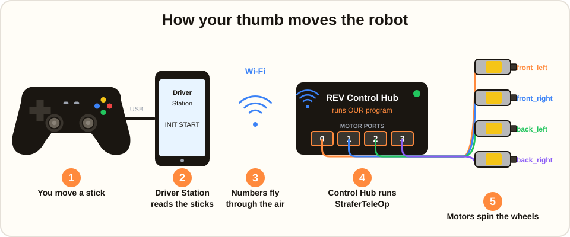
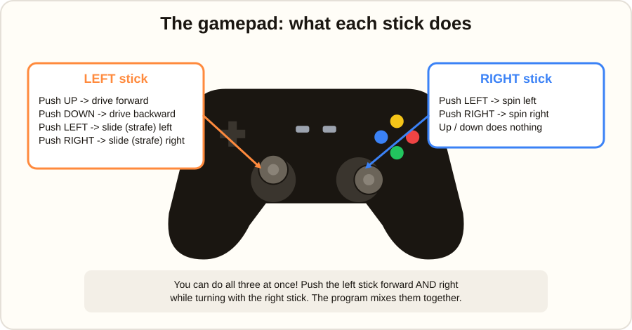
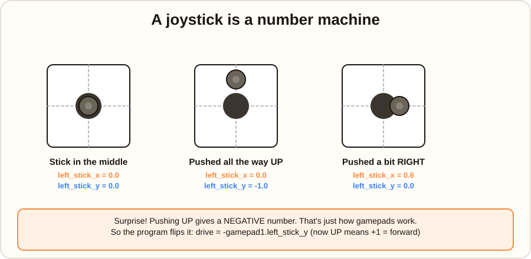
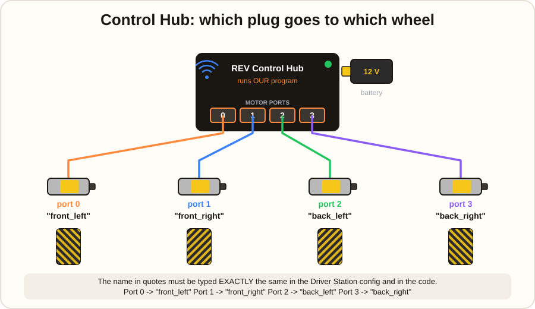
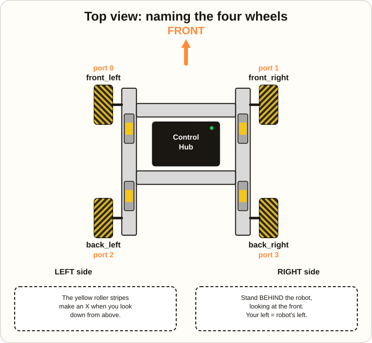
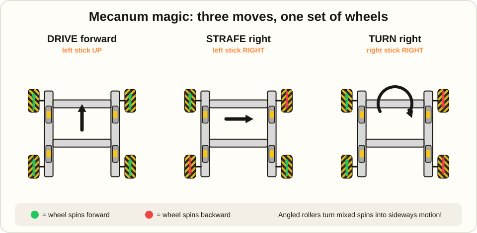
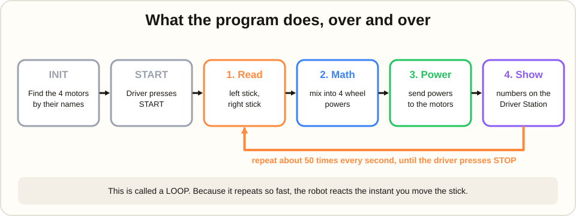
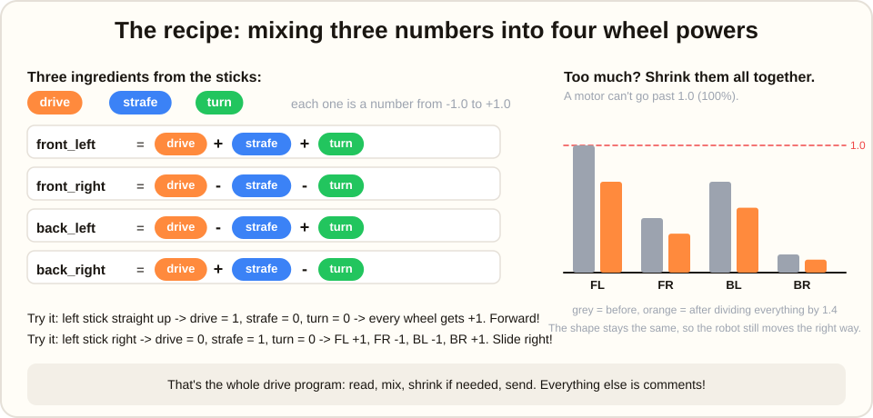
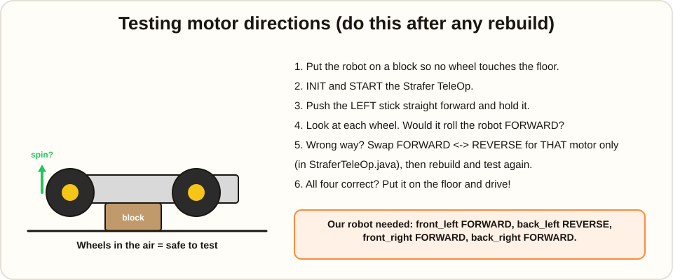

# 🤖 Strafer TeleOp: How Our Robot Drives

Welcome, ApexStrykerz! This page explains the program that lets you drive our robot
with a gamepad. The whole program is one file:
[`StraferTeleOp.java`](src/main/java/org/firstinspires/ftc/teamcode/StraferTeleOp.java).
It is shorter than you think. Read this page first, then open the file. You will
recognize everything.

Prefer a single page you can open anywhere, even without internet? Open
[`docs/StraferTeleOp.html`](docs/StraferTeleOp.html) in any browser. It is this same guide with all the pictures built in.

> **Quick facts**
>
> | | |
> |---|---|
> | Robot chassis | goBILDA Strafer V5 with 4 mecanum wheels |
> | Motors | 4 × goBILDA 5203 Yellow Jacket, 312 RPM |
> | Brain | REV Control Hub |
> | Controller | Gamepad 1 on the Driver Station |
> | OpMode name on the Driver Station | **Strafer TeleOp** |

---

## 1. The big picture

Every time you move a thumb stick, a chain of five things happens, faster than you can blink.



1. **You move a stick.** The gamepad is plugged into the Driver Station with a USB cable.
2. **The Driver Station reads the sticks.** It turns every stick position into numbers.
3. **The numbers fly through the air.** The Driver Station and the Control Hub talk over Wi-Fi.
4. **The Control Hub runs OUR program.** This is where `StraferTeleOp.java` lives and does its math.
5. **The motors spin the wheels.** The Control Hub sends power to each of the four motors.

The Control Hub is the robot's brain. Our program is the *thoughts* inside that brain.

---

## 2. Meet the gamepad



- **Left stick** moves the robot: forward, backward, and sideways (called *strafing*).
- **Right stick** spins the robot in place.
- You can do both at the same time. The program blends them together.

---

## 3. A joystick is a number machine

The program never sees "the stick is up." It only sees numbers.



Each stick gives two numbers, `x` and `y`, from **-1.0** (all the way one direction)
through **0.0** (centered) to **+1.0** (all the way the other direction).

There is one surprise: pushing the stick **up** gives a **negative** `y`. Every gamepad
in the world works this way. So the very first thing our program does is flip it:

```java
double drive  = -gamepad1.left_stick_y;   // the minus sign makes UP = +1 = forward
double strafe =  gamepad1.left_stick_x;   // right = +1
double turn   =  gamepad1.right_stick_x;  // right = +1
```

Now we have three friendly numbers: **drive**, **strafe**, and **turn**.

---

## 4. The Control Hub and the motors

Each motor plugs into a numbered port on the Control Hub. The program finds each motor
by a **name**, and that name is typed into the Driver Station's robot configuration.



| Control Hub port | Name in the configuration | Wheel it drives |
|:---:|---|---|
| 0 | `front_left` | Front left |
| 1 | `front_right` | Front right |
| 2 | `back_left` | Back left |
| 3 | `back_right` | Back right |

In the code, this is how the program asks for the motors:

```java
frontLeft  = hardwareMap.get(DcMotor.class, "front_left");
frontRight = hardwareMap.get(DcMotor.class, "front_right");
backLeft   = hardwareMap.get(DcMotor.class, "back_left");
backRight  = hardwareMap.get(DcMotor.class, "back_right");
```

`hardwareMap` is like a phone book. You give it a name, it hands you the motor.
If a name is spelled differently in the configuration and in the code, the program
stops with an error before the robot even moves. Spelling matters!

---

## 5. Which wheel is which?

The Strafer chassis looks the same from both ends, so **we decided** which end is the front.
The front is the end whose wheels are plugged into ports 0 and 1. We put a label on it.



To tell left from right, stand **behind** the robot and look toward the front.
Your left is the robot's left.

Look closely at the wheels from above. The yellow rollers make an **X** shape.
That X is what makes sideways driving possible. If a wheel is put on backwards,
the X becomes a diamond and strafing stops working.

---

## 6. Mecanum magic

Normal wheels can only roll forward and backward. Mecanum wheels have rollers set at
45 degrees, so when some wheels spin forward and others spin backward, the pushes combine
into sideways motion.



- **Drive forward:** all four wheels spin forward.
- **Strafe right:** front-left and back-right spin forward; front-right and back-left spin backward.
- **Turn right:** both left wheels spin forward; both right wheels spin backward.

Our program does not have three separate modes. It uses one recipe that produces all
three moves, and every mix in between.

---

## 7. What the program does, over and over



When you press **INIT**, the program finds the four motors and sets them up.
When you press **START**, it enters a **loop** and repeats four steps until you press **STOP**:

1. **Read** the sticks.
2. **Do the math** to turn three stick numbers into four wheel powers.
3. **Send** each power to its motor.
4. **Show** the numbers on the Driver Station screen (this is called *telemetry*).

The loop runs about 50 times every second. That is why the robot feels like it responds instantly.

---

## 8. The recipe

Here is the heart of the program. Three numbers in, four numbers out.



```java
double frontLeftPower  = drive + strafe + turn;
double frontRightPower = drive - strafe - turn;
double backLeftPower   = drive - strafe + turn;
double backRightPower  = drive + strafe - turn;
```

**Try it in your head.** Push the left stick straight up: `drive = 1`, `strafe = 0`, `turn = 0`.
Every wheel gets `1 + 0 + 0 = 1`. All four spin forward. The robot drives forward.

Now push the left stick right: `drive = 0`, `strafe = 1`, `turn = 0`.
Front-left gets `+1`, front-right gets `-1`, back-left gets `-1`, back-right gets `+1`.
Compare that with the strafe picture above. It matches!

### One more step: shrinking

A motor's power can only go from -1.0 to +1.0. If you push forward *and* strafe *and* turn
at the same time, a wheel might be asked for `1 + 1 + 1 = 3`. That is impossible.
So the program finds the biggest number and divides **all four** by it. The shape of the
mix stays the same, so the robot still moves the right way, just at full speed instead of
"impossible speed."

```java
double max = Math.max(Math.abs(frontLeftPower), Math.abs(frontRightPower));
max = Math.max(max, Math.abs(backLeftPower));
max = Math.max(max, Math.abs(backRightPower));
if (max > 1.0) {
    frontLeftPower  /= max;
    frontRightPower /= max;
    backLeftPower   /= max;
    backRightPower  /= max;
}
```

Finally the powers go to the motors:

```java
frontLeft.setPower(frontLeftPower);
frontRight.setPower(frontRightPower);
backLeft.setPower(backLeftPower);
backRight.setPower(backRightPower);
```

That is the whole drive program. Everything else in the file is setup and comments.

---

## 9. Testing motor directions

Motors do not know which way is "forward." We tell them. After any rebuild, or if a
motor is swapped, test the directions before driving on the floor.



The directions that work on **our** robot right now are:

```java
frontLeft.setDirection(DcMotor.Direction.FORWARD);
backLeft.setDirection(DcMotor.Direction.REVERSE);
frontRight.setDirection(DcMotor.Direction.FORWARD);
backRight.setDirection(DcMotor.Direction.FORWARD);
```

We found these by testing, not by guessing. The Strafer V5 drives each wheel through
bevel gears, so the pattern is different from robots where the wheels sit right on the motor shafts.

---

## 10. Words to know

| Word | What it means |
|---|---|
| **OpMode** | One program the robot can run. Ours is called Strafer TeleOp. |
| **TeleOp** | "Tele-operated": a human drives with a gamepad. The opposite is Autonomous. |
| **Control Hub** | The robot's brain. Runs our program and powers the motors. |
| **Driver Station** | The phone or Driver Hub with the gamepad plugged in. |
| **hardwareMap** | The phone book that finds motors by name. |
| **Loop** | Code that repeats over and over, very fast. |
| **Power** | A number from -1.0 to +1.0 that tells a motor how hard to spin and which way. |
| **Strafe** | Sliding sideways without turning. Only mecanum or omni wheels can do it. |
| **Telemetry** | Numbers the robot sends back to the Driver Station screen so we can see what it is thinking. |

---

## 11. Challenges: make it yours

Once you understand the program, try changing it. Build, install, test, repeat.

1. **Slow mode.** When the driver holds the left bumper (`gamepad1.left_bumper`), multiply all four powers by 0.4. Great for lining up precisely.
2. **Percentages.** Change the telemetry so wheel powers show as percentages (like `75%`) instead of decimals (like `0.75`).
3. **Swap the sticks.** Make the right stick drive and the left stick turn. Which feels better?
4. **Field-centric thinking.** Right now "forward" means the robot's front. Could you make "forward" always mean *away from the driver*, no matter which way the robot faces? (Hint: the Control Hub has a built-in compass called an IMU. This one is hard!)

---

## 12. Putting the program on the robot

**With Android Studio:** open this project, connect to the Control Hub, and press the green Run button.

**From the terminal** (Mac):

```bash
cd ~/StudioProjects/ApexStrykerz_ftc_2026
./gradlew :TeamCode:assembleDebug
```

Join the Control Hub's Wi-Fi network, then:

```bash
adb connect 192.168.43.1:5555
adb install -r TeamCode/build/outputs/apk/debug/TeamCode-debug.apk
```

Note: the Control Hub's USB-C port does not work with USB-C to USB-C cables. Use Wi-Fi as above,
or a USB-A to USB-C cable with an adapter.

---

*Illustrations are generated SVG files in [`docs/img/`](docs/img/). Questions? Ask a mentor, or better, read the code and try to answer it yourself first.*
