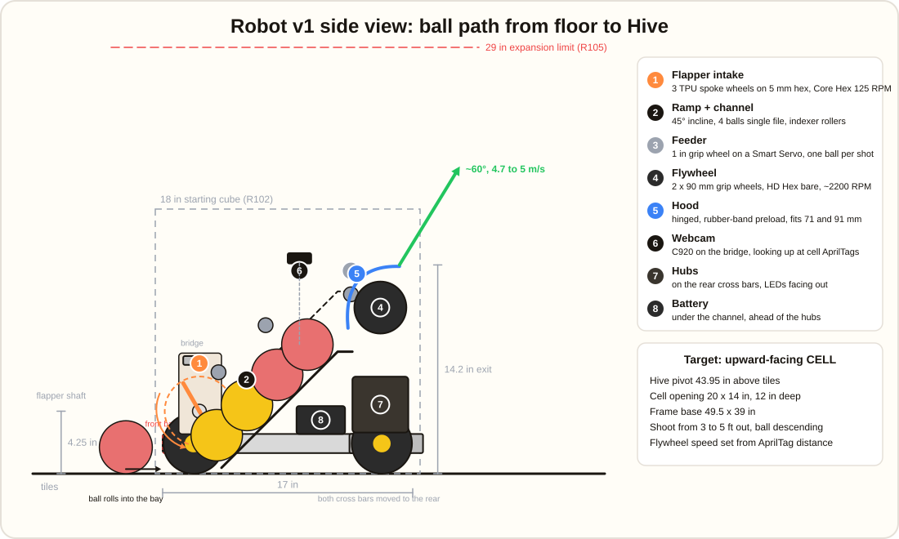
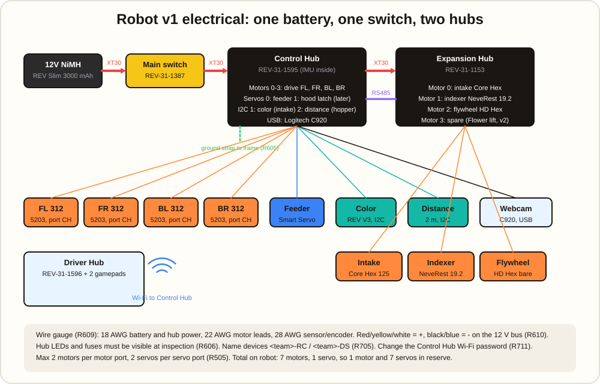

# Robot v1 Design: Intake and Launcher

First-iteration mechanical and electrical design for BIOBUZZ, built on the Strafer V5 chassis
from parts in [inventory.md](inventory.md). Rule references are to the
[Competition Manual digest](BIOBUZZ-manual-digest.md).

**Goal for v1:** collect Pollen off the floor and launch it into our Hive cell, reliably, from a
fixed spot. Leave and park in auto. Nothing else. Flower placement and Garden scoring come in v2.

---

## 1. Design decisions and why

| Decision | Choice | Why |
|---|---|---|
| Ball path | Front intake, single-file inclined channel to a rear-top flywheel | Keeps all 4 balls in a line so the count is enforced by geometry (G407), puts the heavy flywheel over the rear wheels, and leaves the front open for the intake. |
| Capacity | Exactly 4 | Matches the rule limit and the 4 preloads. A 5th ball physically cannot enter once the channel is full. |
| Launcher | Single flywheel shaft with two 90 mm wheels, compliant hood | Simplest launcher that handles both ball sizes. One motor. Every part is in the Starter Kit. |
| Hood | Hinged plate with rubber-band preload | Two ball sizes differ by 20 mm. A fixed hood tuned for 91 mm barely touches a 71 mm ball; a hinged hood compresses both. |
| Feeder | One 1 in soft grip wheel on a Smart Servo, continuous mode | Balls are 25 to 41 g. A servo is enough, and it saves a motor port for v2. |
| Intake | TPU spoke wheels on 8mm REX, driven by the 117 RPM Yellow Jacket | Already designed in `hardware/intake-spokes`. Same shaft standard as the chassis. |
| Aiming | Fixed hood angle, variable flywheel speed, drive to a marked spot; AprilTags for distance in v1.5 | Angle adjustment is a second axis to tune. Speed alone covers 3 to 5 ft. |
| Frame | goBILDA channel for the intake, REV 15 mm extrusion for the tower, printed adapter plates between them | Uses what's on the shelf. Printed plates bridge the M4/M3 hole patterns. |

## 2. Geometry and the 18 inch cube

The Strafer is 17 in long and about 15 in wide at the rails, 4.1 in wheel diameter, and the
channel top sits about 4.6 in above the tiles. That leaves about 13 in of height for everything
else inside the starting cube.

| Element | Height above tiles | Notes |
|---|---|---|
| Intake shaft center | 4.3 in (108 mm) | Spoke tips bottom out at 48 mm, 60% up the average ball. |
| Channel floor entry | ~5 in | Ramp from the intake, 15° to 40° incline rearward. |
| Channel floor at feeder | ~12.6 in | Four 91 mm balls single file need 14.4 in of run; the diagonal has room. |
| Flywheel axle | 15 in | Two 90 mm wheels, so the wheel top is at 16.8 in. |
| Ball exit | ~17.9 in | Just under the cube. The hood is the highest part of the robot. |
| Electronics deck | 5.2 to 7.6 in, rear | Hubs on their side with LEDs facing the outside (R606). |
| Battery | 7.9 to 9.7 in, rear | Low and behind the channel, strapped to a REV battery plate. |

Nothing extends after the match starts in v1, so the 29 in limit (R105) is not used. That is
headroom for a v2 Flower lift.

## 3. Launcher sizing

Target: the upward-facing CELL. The Hive pivot is 43.95 in (1.12 m) up, the cell is 20 in wide,
14 in tall, 12 in deep, and its opening faces up and outward. Treat the aim point as about
48 in (1.22 m) high. Ball exits at 17.9 in (0.45 m), so the ball must climb about 0.77 m.

Projectile speed needed at a 60° launch angle:

| Horizontal distance to aim point | Exit speed |
|---|---|
| 3 ft (0.9 m) | 4.5 m/s |
| 5 ft (1.5 m) | 4.9 m/s |
| 7 ft (2.1 m) | 5.5 m/s |

A ball rolled between a wheel and a hood leaves at about half the wheel surface speed. For 5 m/s
the wheel surface needs about 10 m/s, which on a 90 mm wheel is **about 2100 RPM**. The HD Hex
motor runs 6000 RPM bare, so drive the flywheel shaft 1:1 by chain (two 20T sprockets) and run the
motor at roughly a third of full speed under velocity control. That leaves lots of headroom for
spin-up between shots. Do not add an UltraPlanetary stage; 3:1 would cap the wheel at 2000 RPM
with no margin.

Energy check: a 41 g Nectar at 5 m/s carries 0.5 J. Two 90 mm grip wheels at 2100 RPM store
about 5 J, so each shot drops wheel speed roughly 10 percent and the motor recovers it in well
under half a second. If shots get inconsistent, add a third wheel as a flywheel mass.

**Compression:** aim for 10 to 15 mm of squeeze. That means a wheel-to-hood gap near 78 mm for
Nectar and 58 mm for Pollen. The hinged hood does this automatically: set the resting gap at
about 58 mm and let the rubber bands give 20 mm for the big ball. Tune band count with real
balls. This is the number one thing to test the day the game pieces arrive.

## 4. Mechanical detail by subsystem

### 4.1 Intake
- Shaft: 8mm REX across the front, center 108 mm above tiles, supported in two goBILDA flanged
  8 mm bearings in printed or channel side plates bolted to the front of the Strafer rails.
- Wheels: 3 TPU spoke wheels at 40 mm pitch, alternating wheels turned 90°, held by shaft
  spacers. Print from `hardware/intake-spokes/spoke_wheel.stl`.
- Drive: 117 RPM Yellow Jacket direct on the shaft with a REX hub, or 1:1 by goBILDA
  sprockets if the motor needs to move inboard. Tip speed at 117 RPM on a 120 mm sweep is
  0.7 m/s, faster than the robot drives, which is what you want.
- Guard: a printed or corrugated-plastic shroud above the spokes so a ball can't roll over the
  top of the intake onto the robot (G407 and G409 both encourage this).
- Also reaches into a Flower's bottom slot (3.55 in tall) because the spoke tips sweep down to
  48 mm.

### 4.2 Ramp and channel
- Two side walls of corrugated plastic or 3D-printed panels, 100 mm apart inside, on REV 15 mm
  extrusion rails. Floor is a strip of corrugated plastic. Balls ride single file.
- Two indexer roller stations along the channel, each a pair of REV 1 in soft grip wheels on
  5 mm hex, chained together and to one NeveRest 19.2. They keep balls moving up and hold them
  against the feeder.
- Hard stop at the feeder end so the last ball waits under the feeder wheel.
- A 2 m distance sensor at the channel mouth reads "channel full" so the driver stops the intake.

### 4.3 Feeder
- One REV 1 in soft grip wheel on a Smart Servo set to continuous rotation, mounted above the
  last ball position, pinching it against the channel floor and pushing it into the flywheel.
- Software only runs the feeder when the flywheel is at speed.

### 4.4 Flywheel and hood
- Shaft: 5 mm hex, 135 mm, in two REV bearing pillow blocks on the tower uprights.
- Wheels: two REV 90 mm grip wheels side by side, centered on the channel.
- Motor: HD Hex bare (no gearbox), mounted below and behind, 20T to 20T #25 chain.
- Hood: printed curved plate, about 120° of arc, 110 mm wide, hinged at its lower edge on a
  5 mm hex shaft in pillow blocks, pulled toward the wheel by two to four #33 rubber bands on
  printed hooks. Exit angle about 60°. Print the hood in PETG in two halves if it exceeds the bed.
- Guard: a flat cover over the top of the flywheel so nothing can drop onto it from above.

### 4.5 Tower and mounting
- Four REV 420 mm extrusion uprights and 225 mm cross members form the tower over the rear half
  of the chassis. Bolt to the Strafer rails through printed adapter plates that carry the goBILDA
  8 mm hole pattern on one face and REV M3 slots on the other.
- Keep every printed plate under 200 mm in its longest dimension so it fits the bed with margin.

### 4.6 Electronics deck
- Control Hub and Expansion Hub on a printed or corrugated plate on the rear cross member, both
  standing on edge with LEDs and ports facing the rear or side so inspectors can see them.
- Battery on a REV battery holder plate under the channel, strapped with hook and loop.
- Main switch on the top rear where the driver can reach it, away from the flywheel.
- Webcam on a printed mount at the top of the tower, tilted up about 30°, looking forward and
  up at the Hive cells.

## 5. Electrical

### Port map

| Hub | Port | Device | Wire | Notes |
|---|---|---|---|---|
| Control Hub | Motor 0 | front_left 312 RPM | goBILDA leads, 22 AWG | encoder to Enc 0 |
| Control Hub | Motor 1 | front_right 312 RPM | | encoder to Enc 1 |
| Control Hub | Motor 2 | back_left 312 RPM | | encoder to Enc 2 |
| Control Hub | Motor 3 | back_right 312 RPM | | encoder to Enc 3 |
| Control Hub | Servo 0 | feeder Smart Servo (continuous) | 36 in PWM | program with SRS Programmer |
| Control Hub | I2C 1 | Color Sensor V3 at intake mouth | 50 cm sensor cable | tells Pollen from Nectar |
| Control Hub | I2C 2 | 2 m Distance Sensor at channel top | 100 cm sensor cable | "channel full" |
| Control Hub | I2C 0 | IMU | internal | heading |
| Control Hub | USB | Logitech C920 | | AprilTags |
| Expansion Hub | Motor 0 | intake 117 RPM Yellow Jacket | goBILDA bullet-to-VH adaptor (buy) | encoder optional |
| Expansion Hub | Motor 1 | indexer NeveRest 19.2 | AndyMark 12 in power + encoder cable | |
| Expansion Hub | Motor 2 | flywheel HD Hex | REV JST VH motor cable | encoder required for velocity control |
| Expansion Hub | Motor 3 | spare | | v2 Flower lift |

### Power chain
Battery → REV switch cable → Control Hub XT30 in. Control Hub XT30 out → 50 cm XT30 extension →
Expansion Hub. RS485 3-pin cable between hubs. One resistive grounding strap from a Control Hub
XT30 to the goBILDA frame (R605). Use red/yellow for positive and black for negative on the 12 V
bus (R610). Everything on the 12 V bus is 18 AWG or heavier; the REV and goBILDA cables already are.

### Configuration checklist
- Rename the Control Hub `<team number>-RC` and the Driver Hub `<team number>-DS` (R705).
- Change the Control Hub Wi-Fi password from the default (R711).
- Driver Station config: 4 drive motors as now, plus `intake`, `indexer`, `flywheel` on the
  Expansion Hub, `feeder` servo, `intake_color`, `hopper_distance`, `Webcam 1`.
- Set the feeder Smart Servo to continuous mode with the SRS Programmer before wiring it in.

### Budget against the rules

| | Used in v1 | Limit | Left for v2 |
|---|---:|---:|---:|
| Motors | 7 | 8 | 1 |
| Servos | 1 | 8 | 7 |
| Hubs | 2 | 2 | 0 |
| USB devices | 1 | webcams only | more webcams |

## 6. Parts pulled from inventory

| Subsystem | Parts |
|---|---|
| Intake | 117 RPM Yellow Jacket; 2 goBILDA 8 mm flanged bearings (spare from chassis kit: none, **buy**); 8mm REX shaft 200 to 250 mm (**buy**); 3 printed spoke wheels; goBILDA 8 mm spacers |
| Channel | 4 × REV 420 mm extrusion, 4 × 225 mm, 2 corrugated sheets, 90° and inside-corner brackets |
| Indexer | NeveRest 19.2, 4 × REV 1 in soft grip wheels, 2 × 90 mm hex shaft, 4 pillow blocks, #25 chain, 10T and 15T sprockets, shaft collars |
| Feeder | 1 Smart Robot Servo V2, 1 × 1 in grip wheel, servo shaft adapter, metal bent servo bracket |
| Flywheel | HD Hex motor (gearbox removed), 2 × 90 mm grip wheels, 135 mm hex shaft, 2 bearing pillow blocks, 2 × 20T sprockets, #25 chain, high strength hex hubs, shaft collars |
| Hood | printed PETG hood, 75 mm hex shaft hinge, 2 pillow blocks, #33 rubber bands, printed hooks |
| Electronics | Control Hub, Expansion Hub, 1 Slim battery, switch cable, XT30 50 cm, RS485 50 cm, grounding strap, 36 in PWM, sensor cables, C920, battery holder plate, hook and loop |

### Buy list (small)
1. goBILDA 8mm REX shaft, 8 in / 200 mm or longer, 1 to 2.
2. goBILDA 1611 flanged bearings 8 mm ID, 2 to 4.
3. goBILDA motor power adaptor 3801-0613-0100 and encoder cable 3801-0709-0600, 2 each.
4. goBILDA 8mm REX hub or clamping collar to lock the intake motor to the shaft, 1.
5. PETG and TPU filament.

## 7. 3D printed parts list

| Part | Material | Qty | Size check |
|---|---|---:|---|
| Intake spoke wheel | TPU 95A | 3 | 120 × 20 mm, done |
| Intake side plate with 8 mm bearing pocket and motor mount | PETG | 2 | ~120 × 90 mm |
| Intake top guard | PETG or corrugated plastic | 1 | print in 2 pieces if > 200 mm |
| goBILDA-to-REV adapter plate (8 mm pattern to 15 mm slots) | PETG | 4 | ~96 × 48 mm |
| Hood, curved, hinged | PETG | 1 (2 halves) | each half < 130 mm |
| Rubber band hooks | PETG | 4 | small |
| Hub mounting plate | PETG | 1 | ~180 × 120 mm, or use corrugated plastic |
| Webcam mount, 30° up | PETG | 1 | small |
| Robot sign holders | PETG | 2 | 6.5 × 2.5 in sign, R401 |

## 8. Build order and tests

1. **Electronics first.** Mount both hubs and the battery, wire the power chain, rename devices,
   run the existing TeleOp from the new layout. Self-inspect with the checklist. One session.
2. **Intake.** Side plates, shaft, three spoke wheels, motor. Test with game pieces on blocks
   first, then on the floor. Confirm both ball sizes come up the ramp. Adjust shaft height if
   Nectar pops out.
3. **Flywheel on a bench rig.** Build the flywheel, hood, and feeder on a scrap frame before the
   tower exists. Shoot at a mark 4 ft up from 3, 4, and 5 ft away. Record RPM vs distance for
   both ball sizes. Tune rubber bands. This decides the final hood angle.
4. **Tower and channel.** Build the tower on the chassis, mount the launcher at 15 in axle
   height, add the channel and indexer, connect to the intake ramp.
5. **Integration drive tests.** Fill to 4, drive, shoot 4, repeat. Fix jams.
6. **Auto.** Drive off the wall (LEAVE, 3 pts), shoot 4 preloads, park in the LOADING ZONE
   (5 pts). That is 8 pts plus up to a tip, and most of the SWARM ranking point.

## 9. Risks to watch

- **Two ball sizes through one launcher.** Mitigated by the hinged hood; test early.
- **Balls jamming in the channel** at the ramp-to-channel bend. Keep the inside radius large and
  the walls smooth. Corrugated plastic is fine, plywood is not.
- **Flywheel chain tension** on 1:1 sprockets with no idler. Use the REV tensioning bushings.
- **Control Hub USB and the webcam.** Only one camera in v1. Confirm the C920 enumerates before
  building the mount.
- **Cable strain** at the intake motor. Route along the rail with cable clips; the intake takes hits.
- **Weight bias.** Battery and hubs low and rear balance the front-heavy intake. Check that the
  robot doesn't lift a front wheel under hard braking after the tower goes on.
