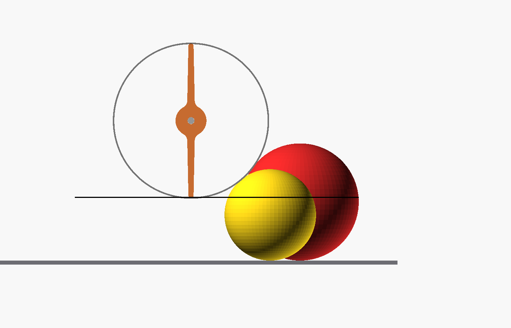
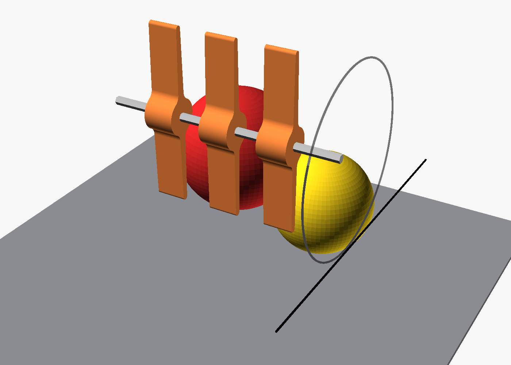

# Intake Spoke Wheel (BIOBUZZ 2026-27)

A two-spoke paddle wheel that mounts on a REV 5 mm hex shaft and sweeps game
pieces into the robot. Several wheels sit side by side on one shaft to make an intake
roller. Printed in TPU so the spokes bend around a ball instead of jamming on it.





## Files

| File | What it is |
|---|---|
| `spoke_wheel.scad` | The parametric model. Open in [OpenSCAD](https://openscad.org) to change any dimension. |
| `spoke_wheel.stl` | Ready to print. One wheel. Print 3 to 5. |
| `preview-*.png` | Renders of the part and of the assembly. |

## Game piece sizes this is designed for

From the 2026-27 FTC Competition Manual, section 9.8. Both are polyethylene balls and
are "not perfectly spherical and may vary in size."

| Piece | Diameter | Weight |
|---|---|---|
| POLLEN (yellow) | 2.8 in / 71 mm | ~25 g |
| NECTAR (red, blue) | 3.6 in / 91 mm | ~41 g |

## Key dimensions

| | mm | Why |
|---|---|---|
| Tip-to-tip | 120 | Long enough to reach over the top of a POLLEN ball and pull it in |
| Width along shaft | 20 | Stiff enough to push, narrow enough to fit 3 to 5 across |
| Hub diameter | 24 | 9.5 mm of wall around the bore, so TPU grips the hex shaft |
| Spoke thickness | 6 at the root, 4 at the tip | Tapered so the tip flexes and the root does not tear |
| Root fillet | 6 | Removes the stress point where spoke meets hub |
| Bore | 5 mm hex (REV) with 0.10 mm interference | Snug press fit on the REV shaft, no set screw needed in TPU. Set `bore = "rex8"` for a goBILDA 8mm REX shaft. |

Measured from the STL: 18.2 cm³ per wheel, about 22 g in TPU at 100% infill, less with 30 to 40 percent infill.

## Mounting height and position

The spoke tips should hit the ball a little above its centre, so the ball is pushed
down and back into the robot rather than popped up. We aimed for 60 percent of the
average ball diameter:

| | mm above the tiles |
|---|---|
| Spoke tips bottom out at | 48.6 (68% up a POLLEN, 53% up a NECTAR) |
| **Shaft centre** | **108.6** (48.6 + 60 tip radius) |

**Where the shaft goes:** inside the frame, not in front of it. The Strafer's rails and
cross bars sit about 36 to 68 mm above the tiles, exactly where a ball is, and the 17 in
chassis leaves only 25 mm of the 18 in starting cube in front. So the front cross bar is
removed, the ball rolls into the open bay between the rails, and the flapper shaft sits
about 76 mm behind the rail fronts on printed side plates, in REV 5 mm hex bearing pillow blocks. The ramp starts about 114 mm
back, behind the sweep, so the ball is caught first and lifted second. See
`docs/robot-v1-design.md` and the intake detail figure for dimensions.

Spin the shaft so the tips move **down at the front** and **back along the bottom**.

## Spacing on the shaft

Put 3 to 5 wheels on one shaft, about 40 mm apart, and stagger them 90 degrees
(every other wheel rotated a quarter turn) so a ball is always being touched by
something. Hold each wheel in place with REV 5 mm hex shaft spacers and shaft
collars on both sides (Starter Kit). The hex drives the wheel; the spacers only stop it sliding.
A REV 400 mm hex shaft spans the 264 mm bay with room for the side plates. Drive it with the
REV Core Hex motor (125 RPM, 5 mm hex output) 1:1 through #25 sprockets or plastic gears.

## Printing in TPU

- Material: TPU, 95A shore hardness (the common flexible filament). Softer TPU will fold instead of pushing.
- Orientation: flat on the bed, the big face down, exactly how the STL is exported.
- Layer height 0.2 mm, 4 perimeters, 30 to 40 percent gyroid infill.
- Slow: 25 to 35 mm/s, minimal retraction, part cooling fan low. TPU strings if rushed.
- No supports needed.
- If the bore is too tight to push on, warm the hub with a hair dryer and press it on, or set
  `bore_clearance = 0` in the `.scad` and re-export.
- Printing a rigid test piece first in PETG or PLA is fine: set `bore_clearance = 0.15`.

## Changing the design

Every number in `spoke_wheel.scad` is a named parameter at the top of the file.
Common tweaks:

| Want to | Change |
|---|---|
| Reach further out | `tip_radius` (then raise the shaft by the same amount) |
| Stiffer or softer spokes | `root_t` and `tip_t` |
| More paddles per turn | `spokes = 3` or `4` |
| Fit a wider or narrower intake | `width` |
| Looser or tighter shaft fit | `bore_clearance` |
| goBILDA 8mm REX shaft instead | `bore = "rex8"` |

Then re-export from the command line or with File → Export in OpenSCAD:

```bash
openscad -o spoke_wheel.stl -D 'part="wheel"' spoke_wheel.scad
```

Assembly preview with three wheels and both balls:

```bash
openscad -o preview-side.png -D 'part="assembly"' --projection=ortho --camera=50,0,75,90,0,0,640 --imgsize=1400,900 spoke_wheel.scad
```

Sources: [BIOBUZZ Competition Manual V1, section 9.8](https://ftc-resources.firstinspires.org/ftc/game/manual),
[AndyMark BIOBUZZ Scoring Elements](https://andymark.com/products/ftc-2026-27-game-preview-pack),
[REV 5 mm hex shafting](https://www.revrobotics.com/rev-41-1362/).
